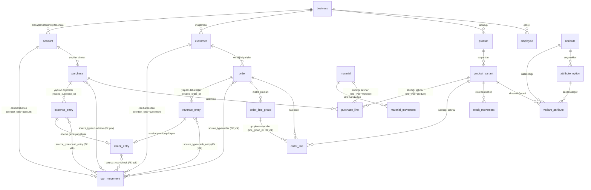

# Veritabanı Şeması — Referans ve Analiz

> **Durum notu (2026-10-03).** Bu dosya `product-schema.md`'nin aksine bir *hedef* şema değil, **şu an gerçekten çalışan** şemanın dökümü — `src/db/schema.ts`'teki 15 migration'ın (v1…v15) birikimli sonucu. Her tablo için kolonlar, PK/FK, index'ler ve "kim/ne için kullanıyor" bilgisi var. Sonda bir **Bulgular** bölümü var: gereksiz/ölü kolonlar, eksik index'ler, zorunlu kılınmayan FK'ler ve bir gerçek hata (CHECK kısıtı).
>
> Kaynağı tek elden güncel tutmak için: yeni bir migration eklerken bu dosyayı da güncelleyin — elle senkron tutulan `design-system`'deki CSS/RN token eşlemesiyle aynı disiplin.

## 0. Motor ve genel kurallar

- **SQLite** (`expo-sqlite`), cihazın kalıcı veri dizininde (`FileSystem.documentDirectory`, cache değil). `PRAGMA journal_mode = WAL` + **`PRAGMA foreign_keys = ON`** — yani aşağıda `REFERENCES` yazan her kolon **gerçekten zorunlu kılınıyor** (SQLite'ta varsayılan kapalıdır, bu projede açık).
- **Migration çalıştırıcı** (`src/db/client.ts`): `_migrations(version PK, name, applied_at)` tablosuna göre, henüz uygulanmamış migration'ları sırayla tek transaction içinde çalıştırır. **Tek yönlü** — geri alma mekanizması yok, "yayınlanmış bir migration'ı asla düzenleme" kuralı var (`schema.ts`'in kendi başlık yorumu).
- **Para:** tüm tutarlar **tam sayı, minor unit** (kuruş/cent) + ayrı `currency` kolonu. Float yok.
- **Zaman:** tüm `*_at`/`date` kolonları **UTC ISO string** (TEXT).
- **Soft delete:** çoğu üst-düzey tablo `deleted_at TEXT` taşır (NULL = aktif). Bazı tablolarda `is_active INTEGER` kullanılır (aynı amaç, farklı temsil — bkz. aşağıdaki tablo notları). **Gerçek `DELETE`** yalnızca "alt veri" sayılan birkaç tabloda var: `order_line`, `purchase_line`, `order_line_group`, `variant_attribute` (yeniden yazılabilir çocuk kayıtlar) ve `product_variant` (yalnızca hiç stok hareketi yoksa — `ProductService.archiveOrDeleteVariant`).
- **Append-only defterler** (hiç `UPDATE`/`DELETE` yolu olmayan tablolar): `stock_movement`, `material_movement`, `cari_movement`. Düzeltme her zaman **yeni bir ters kayıt** ile yapılır, var olan satır asla değişmez.
- Her üst tablo `business_id` taşır (çok kiracılı/tenant izolasyonu) — tek istisna yok; `product_variant`, `purchase_line` gibi "çocuk" tablolar bile kendi `business_id`'sini taşır (join'siz filtre için, bilinçli denormalizasyon).

---

## 1. Kimlik / Tenant

### `business`
| Kolon | Tip | Not |
|---|---|---|
| `id` | TEXT **PK** | |
| `name` | TEXT | |
| `base_currency` | TEXT | |
| `plan_tier` | TEXT CHECK(`solo`,`team`) | |
| `created_at` | TEXT | |
| `allow_negative_stock` | INTEGER DEFAULT 0 | *v3* — negatif stoka izin (işletme ayarı) |
| `last_backup_at` | TEXT NULL | *v4* — `BackupService` |

**Kullanım:** her `ActorContext.business`; `StockService` negatif-stok kuralı için `allow_negative_stock`'u okur.

### `employee`
| Kolon | Tip | Not |
|---|---|---|
| `id` | TEXT **PK** | |
| `business_id` | TEXT **FK→business** | idx |
| `firebase_uid` | TEXT NULL | UNIQUE (partial, NULL hariç) |
| `display_name`, `email`, `phone` | TEXT | |
| `role` | TEXT CHECK(`owner`,`manager`,`production`,`sales`,`viewer`) | RBAC matrisinin anahtarı (`rbac/permissions.ts`) |
| `is_active` | INTEGER | soft-delete yerine |
| `created_at`, `deleted_at` | TEXT | |
| `fcm_token` | TEXT NULL | *v2* — push bildirim |

**Kullanım:** `EmployeeService` (son-owner koruması), her tablonun `created_by`'ı buraya FK.

---

## 2. Katalog (ürün / varyant / eksenler)

### `product`
*v1'de oluşturuldu, v7'de (product_schema_v2_reset) tamamen DROP + yeniden CREATE edildi, v13'te `is_purchasable` eklendi.*

| Kolon | Tip | Not |
|---|---|---|
| `id` | TEXT **PK** | |
| `business_id` | TEXT **FK→business** | idx |
| `name`, `sku` | TEXT | UNIQUE(`business_id`,`sku`) |
| `category` | TEXT NULL | düz metin, ayrı tablo yok (idx var) |
| `description` | TEXT NULL | |
| `unit` | TEXT DEFAULT `'adet'` | |
| `base_price_minor`, `currency` | INTEGER / TEXT | |
| `is_active`, `created_at`, `deleted_at` | | |
| `is_purchasable` | INTEGER DEFAULT 1 | *v13* — Satın Almalar kataloğunda görünsün mü |

**Kullanım:** `ProductService` CRUD; `PurchaseEditor`'ın "Ürünler" filtresi `is_purchasable`'a bakar.

### `product_variant`
*v1 CREATE → v7'de DROP+CREATE (size/color/barcode/cost/price/business_id eklendi) → v10 `image_uri` → v12'de `variant_key` eklendi, `size`/`color` DROP edildi.*

| Kolon | Tip | Not |
|---|---|---|
| `id` | TEXT **PK** | |
| `product_id` | TEXT **FK→product** | idx |
| `business_id` | TEXT **FK→business** | denormalize (join'süz filtre) |
| `sku` | TEXT | UNIQUE(`business_id`,`sku`) |
| `barcode` | TEXT NULL | UNIQUE(`business_id`,`barcode`) partial |
| `attributes` | TEXT DEFAULT `'{}'` | JSON — eksen sistemi dışı serbest alan (örn. `{"heel_height":"3cm"}`), *pratikte neredeyse hiç dolmuyor*, bkz. Bulgular |
| `cost_price_minor`, `price_minor` | INTEGER NULL | COGS / fiyat override |
| `image_uri` | TEXT NULL | *v10* — kalıcı dizindeki `file://` |
| `is_active` | INTEGER | arşiv (stok geçmişi olan varyant hard-delete edilemez) |
| `variant_key` | TEXT NOT NULL DEFAULT `''` | *v12* — `code=value\|code=value` kanonik imza; UNIQUE(`product_id`,`variant_key`); `''` = eksensiz "default" varyant |

**Kullanım:** `ProductService`, eksen sihirbazı (`VariantAxisWizard`), `StockService` (variant_id FK'si her hareketin hedefi), sipariş/satın alma satırları.

### `attribute`, `attribute_option`, `variant_attribute`, `axis_preset`  *(hepsi v12)*

| Tablo | PK | FK | Not |
|---|---|---|---|
| `attribute` | `id` | `business_id→business` | `code`+`name`+`data_type`(`option`/`number`/`text`); UNIQUE(`business_id`,`code`); `is_system=1` → "Renk"/"Beden" (her business için otomatik seed) |
| `attribute_option` | `id` | `attribute_id→attribute` | `value`(kanonik)/`label`(görünen); UNIQUE(`attribute_id`,`value`) |
| `variant_attribute` | **composite PK** (`variant_id`,`attribute_id`) | `variant_id→product_variant`, `attribute_id→attribute`, `option_id→attribute_option` NULL | bir varyantın her ekseni için tek satır; `option_id` **veya** `value_text` **veya** `value_number` dolu (`data_type`'a göre) |
| `axis_preset` | `id` | `business_id→business` | kayıtlı eksen seti ("Ayakkabı 36-46"), `definition` JSON, `use_count`/`last_used_at` yalnızca sıralama için |

**Kullanım:** `AttributeService`, `ProductService.getProductAxes/previewCombinations/commitVariants` — `variant_key`'in **tek** doğrulama mekanizması bu üçlüdür, başka yerde yeniden hesaplanmaz.

---

## 3. Stok

### `stock_movement`  *(append-only, v1 + v9'da `related_purchase_id`)*
| Kolon | Tip | Not |
|---|---|---|
| `id` | TEXT **PK** | |
| `business_id` | **FK→business** | idx |
| `variant_id` | **FK→product_variant** | idx(`variant_id`,`created_at`) |
| `type` | CHECK(`in`,`out`,`adjustment`) | |
| `quantity` | INTEGER | `adjustment` hariç her zaman pozitif büyüklük |
| `reason`, `note` | TEXT NULL | |
| `related_order_id` | TEXT NULL | **FK YOK** (bkz. Bulgular) |
| `related_purchase_id` | TEXT NULL **FK→purchase** | *v9* |
| `created_by` | **FK→employee** | |
| `created_at` | TEXT | |

**Kullanım:** `StockService.recordMovement` (tek yazma noktası), `OrderService.reconcileShipmentStock` (`related_order_id` ile diff), `PurchaseService.reconcileStock` (`related_purchase_id` ile diff). **Hiç `UPDATE`/`DELETE` yok** — düzeltme her zaman yeni bir ters hareket.

### `stock_level`  *(v1 + v7'de `reorder_quantity`)*
| Kolon | Tip | Not |
|---|---|---|
| `variant_id` | TEXT **PK, FK→product_variant** | 1:1 |
| `on_hand` | INTEGER DEFAULT 0 | hızlı erişim — `stock_movement`'tan servis katmanında türetilip burada tutulur (trigger yok, kasıtlı: negatif-stok kuralı önce uygulama kodunda çalışsın diye) |
| `low_stock_threshold` | INTEGER DEFAULT 0 | 0 = "düşük stok" uyarısı kapalı |
| `reorder_quantity` | INTEGER DEFAULT 0 | *v7* — eşiğe vurunca ne kadar sipariş edilecek; **henüz hiçbir ekran/servis okumuyor** (bkz. Bulgular) |

---

## 4. Malzeme (axis-free hammadde)

### `material`, `material_movement`  *(v13)*
| Tablo | PK/FK | Not |
|---|---|---|
| `material` | `id` PK, `business_id→business` | `unit` serbest metin (m², kg…); `stock_quantity` **REAL** (2,5 m² gibi ondalık); `status` CHECK(`active`,`archived`) |
| `material_movement` | `id` PK, `material_id→material`, `related_purchase_id→purchase` NULL, `created_by→employee` | append-only, `quantity` REAL (işaretli — `+`/`−`) |

**Kullanım:** `MaterialService`, `PurchaseService.reconcileStock` (malzeme satırları için — ürün satırlarının `stock_movement` eşdeğeri).

---

## 5. Sipariş (satış)

### `customer`  *(v1 + v15'te `currency`)*
`id` PK, `business_id→business`, `name`, `primary_channel`, `contact_ref`, `is_active`, `deleted_at`, `currency` TEXT NULL (*v15* — cari para birimi, NULL=işletme para birimi).

### `"order"`  *(v1; v5 `note`; v11 `delivery_date`; v15 brüt/iskonto/net)*
| Kolon | Tip | Not |
|---|---|---|
| `id` | **PK** | |
| `business_id` | **FK→business** | idx |
| `customer_id` | **FK→customer** | idx |
| `status` | CHECK(`draft`,`confirmed`,`in_production`,`ready`,`shipped`) | |
| `source` | CHECK(`manual`,`nlp`) | Faz 2 tohumu, bugün hep `manual` |
| `currency`, `created_by`, `created_at`, `deleted_at` | | |
| `note` | TEXT NULL | *v5* |
| `delivery_date` | TEXT NULL | *v11* |
| `gross_total_minor` | INTEGER DEFAULT 0 | *v15* |
| `discount_type` | CHECK(`amount`,`percent`) NULL | *v15* |
| `discount_value` | INTEGER DEFAULT 0 | *v15* — tutar: minor unit; yüzde: ×100 |
| `discount_amount_minor` | INTEGER DEFAULT 0 | *v15* |
| `net_total_minor` | INTEGER DEFAULT 0 | *v15* — **cariye yazılan tutar budur** |

### `order_line`  *(v1 + v14 `line_group_id`)*
`id` PK, `order_id→order`, `variant_id→product_variant`, `quantity` INTEGER, `unit_price_minor`, `line_group_id` TEXT NULL (**FK yok** — bkz. Bulgular, hedefi `order_line_group.id`). Gerçek `DELETE`/yeniden yazma ile yönetilir (`OrderService.saveLines`: toptan sil + yeniden yaz).

### `order_line_group`, `assortment_pattern`  *(v14)*
| Tablo | PK/FK | Not |
|---|---|---|
| `order_line_group` | `id` PK, `order_id→order`, `product_id→product` | bir matrisin (= bir ürünün) sipariş satırlarını gruplar; `assortment_pattern`/`assortment_sets` dolu ise asorti ile girilmiş |
| `assortment_pattern` | `id` PK, `business_id→business`, `customer_id→customer` NULL | kayıtlı desen ("1-2-2-2-1"); `customer_id` NULL = işletme geneli |

**Kullanım:** `OrderService.saveLines/lineGroups`, `OrderLinesSummary` (ürün başına sıkıştırılmış görünüm), `AssortmentService`.

---

## 6. Satın alma (tedarikçiden/fasoncudan alım)

### `account`  *(v8 + v15'te `currency`)*
`id` PK, `business_id→business`, `name`, `note`, `is_active`, `created_at`, `deleted_at`, `currency` NULL (*v15*). Müşteri *olmayan* her üçüncü taraf (tedarikçi, fasoncu, ev sahibi…) — `Customer`'ın alım tarafındaki eşleniği.

### `purchase`  *(v9 + v13'te gerçek teslim-alma alanları)*
| Kolon | Tip | Not |
|---|---|---|
| `id` | **PK** | |
| `business_id` | **FK→business** | idx |
| `account_id` | **FK→account** | idx |
| `status` | CHECK(`draft`,`ordered`,`received`) | **LEGACY** — `is_received` asıl kaynak, `status` yalnızca eski tüketiciler için senkron tutulur (bkz. Bulgular) |
| `currency`, `note`, `created_by`, `created_at`, `deleted_at` | | |
| `purchase_date` | TEXT DEFAULT `''` | *v13* |
| `is_received` | INTEGER DEFAULT 0 | *v13* — **asıl kaynak** |
| `received_at` | TEXT NULL | *v13* |
| `updated_at` | TEXT DEFAULT `''` | *v13* |

### `purchase_line`  *(v9 CREATE → v13'te TAMAMEN YENİDEN KURULDU — `purchase_line_v2` olarak yaratılıp rename edildi)*
| Kolon | Tip | Not |
|---|---|---|
| `id` | **PK** | |
| `purchase_id` | **FK→purchase** | idx |
| `line_type` | CHECK(`material`,`product`) | |
| `material_id` | **FK→material** NULL | `line_type='material'` ⇒ dolu |
| `variant_id` | **FK→product_variant** NULL | `line_type='product'` ⇒ dolu |
| `quantity` | **REAL** | malzemede ondalık (2,5 m²) |
| `unit` | TEXT DEFAULT `'adet'` | satır yazılırken malzeme/üründen kopyalanan anlık görüntü |
| `unit_cost_minor`, `line_total_minor` | INTEGER DEFAULT 0 | fiyat — **asla stoğa dokunmaz** |
| `line_group_id` | TEXT NULL | **FK yok, hedef tablosu da yok** — aslında `product_id`'nin kopyası (matris girişini gruplamak için), `order_line_group` gibi ayrı bir tabloya karşılık gelmiyor (bkz. Bulgular) |
| `note` | TEXT NULL | |
| **CHECK** | | `line_type` ile `material_id`/`variant_id` tutarlılığı DB seviyesinde zorunlu |

**Kullanım:** `PurchaseService.save/reconcileStock` — stok/malzeme hareketleri `related_purchase_id` ile bu satırların TOPLAMINA göre (fark mantığıyla) eşitlenir, asla üzerine yazılmaz.

---

## 7. Finans (gelir / gider / çek) + Cari defter

### `expense_entry`, `revenue_entry`
*v1 CREATE → v8'de üç "kime/kimden" FK'si → v9'da `expense_entry.related_purchase_id` → v15'te `cari_excluded` (ikisi) + `revenue_entry.category`.*

| Kolon | `expense_entry` | `revenue_entry` | Not |
|---|---|---|---|
| `id` | PK | PK | |
| `business_id` | FK→business | FK→business | idx(`business_id`,`date`) |
| `category` | CHECK(5 değer) | TEXT NULL *(v15, CHECK YOK)* | gider: zorunlu enum; gelir: yalnızca "cari dışı" iken dolu (faiz/hurda/kira) |
| `source` | — | CHECK(`order`,`manual`) | |
| `amount_minor`, `currency`, `date`, `note` | | | |
| `related_order_id` | TEXT NULL, **FK yok** | TEXT NULL, **FK yok** | |
| `related_purchase_id` | TEXT NULL **FK→purchase** *(v9)* | — | |
| `related_customer_id` | **FK→customer** NULL *(v8)* | **FK→customer** NULL *(v8)* | |
| `related_employee_id` | **FK→employee** NULL *(v8)* | **FK→employee** NULL *(v8)* | |
| `related_account_id` | **FK→account** NULL *(v8)* | **FK→account** NULL *(v8)* | en fazla BİRİ dolu — DB değil, `FinanceService.resolvePartyLink` zorunlu kılıyor |
| `payment_method` | CHECK(`cash`,`credit_card`,`check`) | CHECK(`cash`,`credit_card`,`check`) | **⚠ `'deposit'` CHECK'te yok — bkz. Bulgular, gerçek hata** |
| `created_by` | FK→employee | FK→employee | |
| `deleted_at` | | | soft-delete (`FinanceService.voidExpense/voidRevenue`) |
| `cari_excluded` | INTEGER DEFAULT 0 *(v15)* | INTEGER DEFAULT 0 *(v15)* | 1 = kullanıcı bilinçli "Cari dışı" dedi |

**Kullanım:** `FinanceService.createExpense/createRevenue` (tek yazma noktası — kasa kaydı + `cari_movement` aynı transaction'da), `voidExpense/voidRevenue` (soft-delete + ters cari hareket), raporlar (`ReportService`).

### `check_entry`  *(v1, hiç değişmedi)*
`id` PK, `business_id→business`, `direction` CHECK(`received`,`issued`), `related_entry_id` TEXT (**polimorfik, FK yok** — ya `expense_entry` ya `revenue_entry`'ye işaret eder), `related_entry_type` CHECK(`ExpenseEntry`,`RevenueEntry`), `check_number`, `bank_name`, `amount_minor`, `currency`, `issue_date`, `due_date`, `status` CHECK(`pending`,`cleared`,`bounced`,`cashed`), `note`, `created_by→employee`, `created_at`, `deleted_at`. idx: `business_id`; partial idx `due_date WHERE status='pending'`.

**Kullanım:** `FinanceService.maybeCreateCheck/updateCheckStatus`; `CariService.syncCheckBounce` — alınmış bir müşteri çeki `bounced` olunca cariyi yeniden borçlandırır.

### `cari_movement`  *(v15, append-only, TEK bakiye kaynağı)*
| Kolon | Tip | Not |
|---|---|---|
| `id` | **PK** | |
| `business_id` | **FK→business** | idx |
| `contact_type` | CHECK(`customer`,`account`) | |
| `contact_id` | TEXT | **FK yok** (polimorfik — `customer.id` ya da `account.id`) — idx(`contact_type`,`contact_id`) |
| `movement_date` | TEXT | |
| `type` | CHECK(10 değer: `shipment`,`collection`,`payment`,`purchase`,`return_in`,`return_out`,`discount_close`,`opening`,`check_bounce`,`reversal`) | |
| `side` | CHECK(`debit`,`credit`) | Borç/Alacak |
| `amount_minor` | INTEGER **CHECK > 0** | işlem para biriminde, daima pozitif |
| `currency` | TEXT | işlem para birimi |
| `exchange_rate` | REAL NULL | yalnızca `currency ≠` carinin para birimi |
| `amount_in_cari_minor` | INTEGER **CHECK > 0** | **bakiye bundan hesaplanır**, carinin para biriminde |
| `source_type` | CHECK(`order`,`cash_entry`,`check`,`purchase`,`return`,`manual`) | idx(`source_type`,`source_id`) |
| `source_id` | TEXT NULL | **FK yok** (polimorfik — `order.id`/`expense_entry.id`/`revenue_entry.id`/`purchase.id`/`check_entry.id`) |
| `reverses_id` | TEXT NULL | **FK yok** — kendi tablosuna (`cari_movement.id`) işaret eder ama deklare edilmemiş |
| `reason` | TEXT NULL | |
| `created_by` | **FK→employee** | |
| `created_at`, `updated_at` | TEXT | |
| `deleted_at` | TEXT NULL | **hiçbir kod yolu bunu yazmıyor** — bkz. Bulgular |

**Kullanım:** `CariService` — TEK yazma kapısı `post()`; `ledger()`/`balances()` bakiyeyi SADECE bu tablodan (Σ borç − Σ alacak) hesaplar. `reconcileSource` (sevkiyat/alım senkronu) ve `voidCashEntry` (ödeme/tahsilat silme) her ikisi de **yeni** satır ekler, var olanı hiç değiştirmez.

---

## 8. Görev / Mesai (HR — finans/cariyle ilişkisiz)

### `task`  *(v1)*
`id` PK, `business_id→business`, `title`, `description`, `assignee_id→employee`, `status` CHECK(`todo`,`in_progress`,`done`), `due_date`, `related_order_id` TEXT (**FK yok**), `created_by→employee`, `created_at`, `deleted_at`. idx: `business_id`, `assignee_id`.

### `shift`  *(v1 + v6'da `duration_hours`)*
`id` PK, `business_id→business`, `employee_id→employee`, `date`, `note`, `duration_hours` INTEGER DEFAULT 8 (*v6*). idx: `business_id`, (`employee_id`,`date`).

---

## 9. İlişki özeti (kim kime bağlı)

*(Mermaid bu tablo kadar ayrıntılı değil — CHECK kısıtları, hangi FK'nin deklare EDİLMEDİĞİ gibi nüanslar için yukarıdaki tablolara bakın. "FK yok" notlu bağlar, diyagramda okunabilirlik için çizildi ama DB'de `REFERENCES` ile zorunlu kılınmıyor.)*

---

## 10. Bulgular — verimlilik, gereksiz kayıt, eksik kısıt

### 10.1 — Gerçek hata: `payment_method` CHECK kısıtı `'deposit'`i kapsamıyor
`expense_entry` ve `revenue_entry`'nin `payment_method` kolonu migration 1'den beri `CHECK (payment_method IN ('cash','credit_card','check'))`. Ama uygulama kodu (`models/common.ts`'teki `PaymentMethod` tipi, Para/Müşteri/Hesap ekranlarındaki `METHODS` listeleri) dördüncü bir değer sunuyor: **`'deposit'` (Kapora)**. Kullanıcı "Kapora" seçip bir gelir/gider kaydı kaydetmeye çalışırsa, SQLite bu `INSERT`'i CHECK ihlali ile reddeder — ham bir veritabanı hatası olarak kullanıcıya yansır (`fakeRepository` bu kısıtı uygulamadığı için test paketi bunu hiç yakalamıyor). **Düzeltme bir migration gerektirir** (SQLite'ta CHECK kısıtı yerinde ALTER edilemez — tablo `purchase_line` gibi yeniden kurulmalı). İstersen bunu ayrı bir migration (v16) olarak hemen yazabilirim.

### 10.2 — Bu oturumda çözülen hatanın kök nedeni (referans için)
`PurchaseService.softDelete` bir alımı silerken **kasıtlı olarak** o alıma yapılmış `expense_entry` ödemelerine dokunmaz — ödeme gerçek bir nakit olayıdır, alım kaydı hatalıydı diye ödeme de "hiç olmamış" sayılamaz. Bu doğru davranış. Asıl hata UI katmanındaydı: `cari_movement` defteri asla düzenlenmediği için (append-only), silinen bir ödemenin ORİJİNAL hareketi listede kalıcı olarak görünmeye devam ediyordu ve "Sil" düğmesi hâlâ gösteriliyordu — ikinci tıklama zaten soft-delete edilmiş kaydı tekrar aramaya çalışıp "Kayıt bulunamadı" ile patlıyordu. Düzeltme: `lib/cari.ts`'e `alreadyVoidedMovementIds()` eklendi (bir hareketi işaret eden `reverses_id` varsa o hareket "silindi" sayılır), `CariLedgerView` artık bu hareketlerde "Sil"i göstermiyor, "Silindi — ters hareketle kapatıldı" etiketiyle soluk gösteriyor.

### 10.3 — `purchase.status` fiilen ölü/gereksiz kolon
`is_received`/`received_at` (migration 13) asıl kaynak; `status` yalnızca "eski tüketiciler bozulmasın" diye `PurchaseService` tarafından senkron tutuluyor (`'received'`/`'draft'` — `'ordered'` değeri artık hiç yazılmıyor). Hiçbir sorgu/ekran `status`'u okumuyor. SQLite CHECK kısıtları yerinde değiştirilemediği için düşürülmesi `purchase` tablosunun `purchase_line` gibi yeniden kurulmasını gerektirir — bu küçük bir alan, şimdilik dokunmaya değmez, ama "neden hâlâ duruyor" sorusu gelirse cevap bu.

### 10.4 — `cari_movement.deleted_at` yazılmayan kolon
Şema bu kolonu taşıyor ve her sorgu (`listByContact`/`listBySource`/`listByBusiness`) savunma amaçlı `AND deleted_at IS NULL` filtresi uyguluyor, ama **hiçbir kod yolu bu kolona yazmıyor** (append-only tasarım gereği — "silme" yerine ters hareket var). Zararsız ama kalıntı; ileride bu tabloya gerçek bir "düzeltmeyi gizle" özelliği eklenirse hazır duruyor.

### 10.5 — `stock_level.reorder_quantity` hiç okunmuyor
Migration 7'de "eşiğe vurunca ne kadar sipariş edilecek" diye eklendi, `StockService.setReorderQuantity` ile yazılabiliyor ama hiçbir ekran/rapor/bildirim bunu okumuyor. Satın alma modülü henüz düşük-stok eşiğine bağlı otomatik öneri üretmiyor. Kullanılmayan ama ileri hazırlık olarak masrafsız duran bir alan.

### 10.6 — Deklare edilmemiş ("yumuşak") FK'ler
`PRAGMA foreign_keys = ON` olduğu için deklare edilen her `REFERENCES` gerçekten zorunlu kılınıyor — ama şu kolonlar **düz `TEXT`**, hiçbir constraint yok:
- `stock_movement.related_order_id`, `task.related_order_id`, `expense_entry.related_order_id`, `revenue_entry.related_order_id` — tek bir hedefe işaret ettikleri için FK eklenebilirdi, eklenmemiş (muhtemelen gözden kaçmış, kasıtlı değil).
- `order_line.line_group_id → order_line_group.id` — gerçek bir hedefi var ama deklare edilmemiş.
- `purchase_line.line_group_id` — aslında bir `product.id` kopyası (ayrı bir "purchase_line_group" tablosu hiç yok), `order_line.line_group_id`'den farklı bir kavram ama aynı isim — isim çakışması kafa karıştırıcı.
- `cari_movement.contact_id`, `source_id`, `reverses_id` — **bilinçli olarak** FK'siz (polimorfik: `contact_id` ya `customer` ya `account`'a, `source_id` beş farklı tabloya işaret edebiliyor). `reverses_id` ise tek bir hedefe (`cari_movement.id`) işaret ediyor, FK eklenebilirdi.
- `check_entry.related_entry_id` — polimorfik (`expense_entry`/`revenue_entry`), aynı gerekçeyle FK'siz.

Soft-delete ağırlıklı bir sistemde bunların pratik riski düşük (satırlar nadiren gerçekten silinir), ama `order_line`/`purchase_line` gibi **gerçekten silinen** alt tablolarla birleştiğinde (ör. bir ürün varyantı hard-delete edilirse) teorik olarak sahipsiz referans bırakabilir.

### 10.7 — `ProductService.archiveOrDeleteVariant` yalnızca `stock_movement`'a bakıyor
Bir varyantı "gerçekten sil" (hard delete) kararı yalnızca `stock_movement` geçmişine bakılarak veriliyor; `order_line`/`purchase_line` kontrol edilmiyor. `order_line.variant_id` ve `purchase_line.variant_id` **FK ile zorunlu kılındığı için** (bölüm 10.6'nın aksine bunlar deklare edilmiş FK'ler), böyle bir varyantı silmeye çalışmak pratikte veri bozulmasına yol açmaz — SQLite `DELETE`'i FK ihlali ile reddeder. Ama bu, kullanıcıya "stok hareketi yok, silinebilir" diye bir onay gösterip sonra ham bir DB hatasıyla başarısız olmak anlamına gelebilir. Kontrolü `order_line`/`purchase_line` sayısını da kapsayacak şekilde genişletmek daha temiz bir hata mesajı verir.

### 10.8 — Index kapsamı: küçük ölçekte sorun değil, büyürse bakılmalı
`expense_entry`/`revenue_entry` yalnızca (`business_id`,`date`) üzerinde indeksli; ama en sık çalışan sorgular `related_purchase_id`, `related_account_id`, `related_customer_id`, `related_order_id` üzerinden filtreliyor (`listByPurchase`, cari eşleştirme, vb.) — bunlar bugün tam tablo taraması. Aynı şekilde `stock_movement.related_order_id`/`related_purchase_id` üzerinde de index yok (`listByOrder`/`listByPurchase` bu oturumda eklendi). Bir işletmenin yıllık birkaç yüz/bin satırlık hacminde bunun ölçülebilir bir etkisi yok; binlerce kayda ulaşan işletmeler için ek index'ler (`CREATE INDEX ... ON expense_entry(related_purchase_id)` vb.) ucuz bir gelecek adımı.

### 10.9 — `product_variant.attributes` JSON kolonu fiilen kullanılmıyor
Migration 7'nin yorumunda "eksen sistemi dışı serbest kaçış kapısı" olarak tanımlanmış (örn. `{"heel_height":"3cm"}`), ama eksen sistemi (migration 12, `attribute`/`variant_attribute`) geldikten sonra hiçbir ekran bu JSON'u okumuyor/yazmıyor — her varyant oluşturulurken `'{}'` olarak sabitleniyor. Kaldırılması gereken aktif bir risk değil (NOT NULL DEFAULT, boşsa zararsız), ama "neden hâlâ var" sorusunun cevabı budur; gerçek kullanım alanı eksen sistemi devraldı.

### 10.10 — Tasarım gereği sınırsız büyüyen tablolar (sorun değil, bilgi notu)
`stock_movement`, `material_movement`, `cari_movement` append-only — hiç arşivlenmiyor/temizlenmiyor. Küçük bir üretici/B2B ekibin yıllık hacminde (bu oturumdaki gerçek veri: birkaç yüz hareket) bu önemsiz; sorgular zaten `business_id`/`variant_id`/`contact_id` ile filtrelendiği için büyüme doğrudan performansı etkilemez. Yıllar içinde on binlerce satıra ulaşırsa bölümleme/arşivleme gündeme gelebilir — bugün için bir aksiyon gerektirmiyor.

---

## 11. Önerilen sıradaki adımlar (öncelik sırasıyla)

1. **(Gerçek hata)** `payment_method` CHECK'ine `'deposit'`i ekleyen bir migration (v16) — `expense_entry`/`revenue_entry` için `purchase_line`'da yapıldığı gibi tabloyu yeniden kurmayı gerektirir. İstersen hemen yazarım.
2. `order_line.line_group_id → order_line_group(id)` için deklare edilmiş FK (yeni migration, kolonu DROP+ADD ile yeniden kurmak gerekir — SQLite ALTER TABLE ADD COLUMN'da REFERENCES'ı destekler ama var olan bir kolona sonradan FK eklenemez).
3. `ProductService.archiveOrDeleteVariant`'ın hard-delete kontrolüne `order_line`/`purchase_line` sayımını eklemek (küçük bir servis değişikliği, migration gerekmiyor).
4. Ölçek büyürse: `expense_entry`/`revenue_entry`/`stock_movement`'ın `related_*` kolonlarına index.

Bunların hiçbiri acil değil — 1. madde dışında hepsi "bir gün lazım olursa" seviyesinde. 1. madde gerçek bir kullanıcı-karşılaşabilir hata, ne zaman isterseniz düzeltebilirim.
